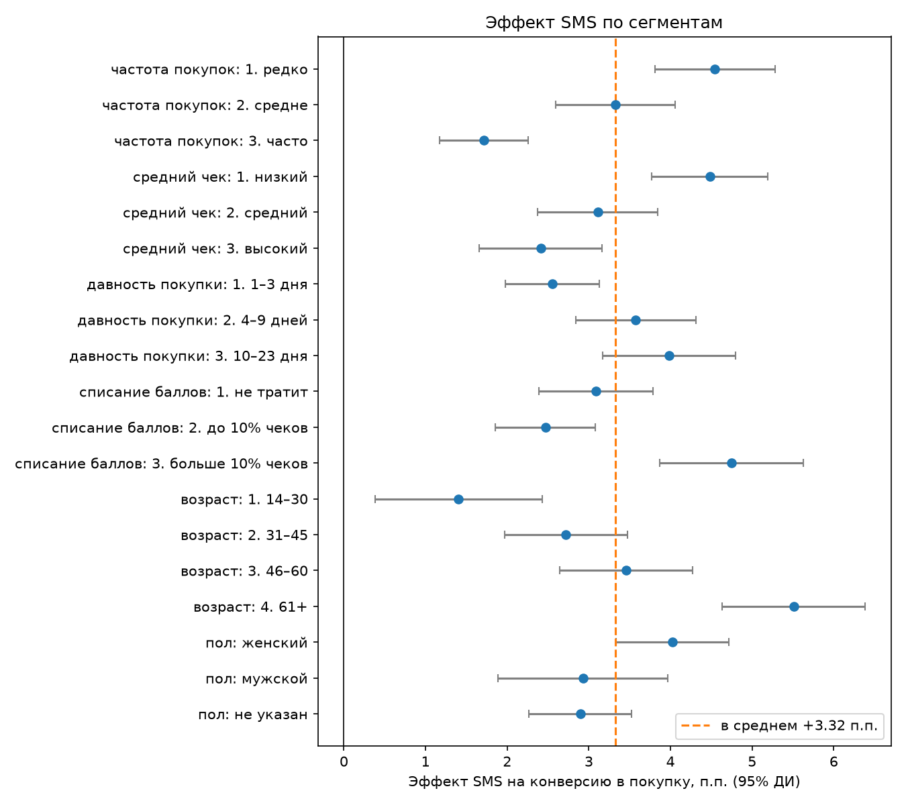
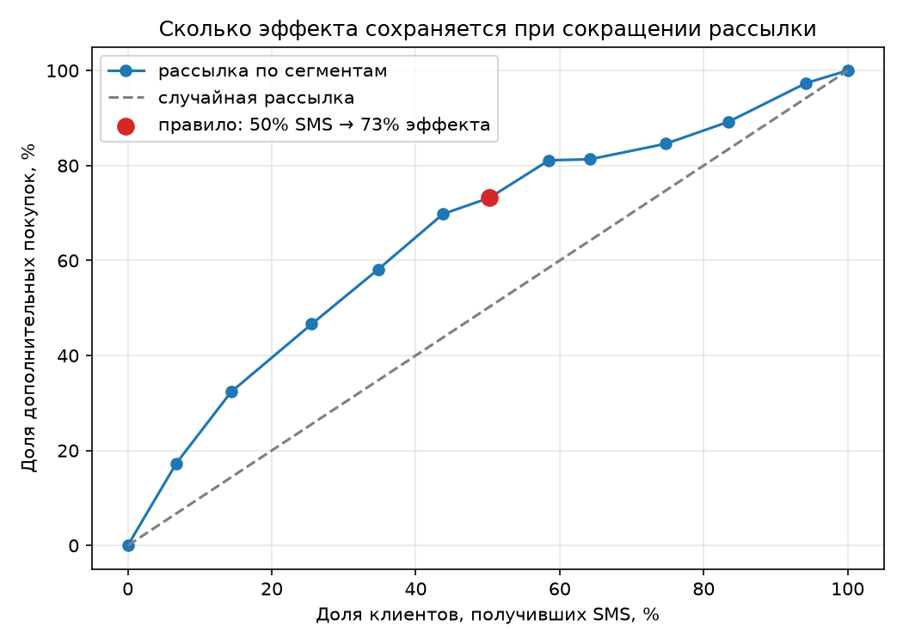

# Аудит промо-рассылки X5

В 2019 году X5 провела эксперимент: часть клиентов получила промо-SMS, часть не получила. Данные эксперимента открытые, это датасет [X5 RetailHero](https://ods.ai/competitions/x5-retailhero-uplift-modeling).

В проекте я проверяла, работает ли рассылка, на каких клиентах она даёт больше всего покупок и можно ли отправлять меньше SMS, почти не теряя эффект.

Стек: SQL (DuckDB), Python, Pandas, Statsmodels и Matplotlib.

## Результаты

SMS действительно работает. Без рассылки покупку сделали 60,33% клиентов, с рассылкой 63,65%. Разница +3,32 п.п., 95% доверительный интервал от +2,90 до +3,75 п.п., p < 0,001.

При этом 60% клиентов покупают и без SMS. На разных группах эффект сильно отличается: у клиентов 14–30 лет он +1,4 п.п., у клиентов 61+ уже +5,5 п.п. Слабее всего SMS действует на тех, кто и так часто покупает.

Если отправлять SMS только редким покупателям и клиентам со средней частотой покупок старше 46 лет, то половина рассылки даёт 73% всех дополнительных покупок. Вторая половина SMS даёт только 27%. Правило я подбирала на одной случайной половине клиентов, а проверяла на другой, чтобы не подогнать результат под данные.

Если считать, что одна SMS стоит 2 руб., а маржа 20%, то рассылка по правилу выгоднее рассылки всем примерно на 24 тыс. руб. на каждые 100 тыс. клиентов. Рассылка всем выигрывает только при очень дешёвой SMS или высокой марже.

## Выводы и рекомендации

1. Не отправлять SMS всем подряд. Если слать только редким покупателям и клиентам старше 46 лет со средней частотой покупок, SMS нужно в 2 раза меньше, а дополнительных покупок останется 73%.
2. Частым покупателям и клиентам 14–30 лет SMS почти ничего не добавляет, они и так покупают. Для них стоит попробовать другой оффер или другой канал, а не ту же рассылку.
3. Перед тем как внедрять правило, проверить его отдельным A/B-тестом (рассылка выборочно против рассылки всем). Главная метрика - прибыль на клиента, а не конверсия.
4. Собирать сумму покупки после рассылки и стоимость скидки. Тогда экономику можно будет считать по факту, а не по допущениям.





## Данные

- uplift_train: 200 039 клиентов, для каждого известно, получил ли он SMS и купил ли что-то после
- clients: возраст, пол, дата выдачи карты и дата первого списания баллов
- purchases: 45,8 млн строк истории покупок с 21.11.2018 по 18.03.2019

## Что сделано

1. Разобралась со структурой данных (01_data_check). Одна строка в purchases это не чек, а товар в чеке, а сумма чека повторяется в каждой строке. Поэтому средний чек считаем по уникальным чекам.
2. Проверила сам эксперимент (02_experiment). Группы одинакового размера и похожи по возрасту, полу и стажу карты. Нашла утечку данных: в поле first_redeem_date есть даты после рассылки, у 22 785 клиентов. То есть часть клиентов впервые потратила баллы как раз из-за SMS. Поэтому брала только историю до 18.03.2019.
3. Собрала профиль каждого клиента на SQL (03_features, sql/01_client_features.sql): сколько раз покупал, средний чек, как давно была последняя покупка, как часто тратит баллы.
4. Поделила клиентов на сегменты на SQL с помощью NTILE и CASE (04_segments, sql/02_client_segments.sql) и в каждом сегменте посчитала A/B-тест. Так как проверок получилось много, применила поправку Холма.
5. Подобрала правило, кому отправлять SMS, и посчитала экономику при разной стоимости SMS и марже (05_targeting).

## Ограничения

В данных есть только факт покупки, но нет её суммы. Поэтому доход с дополнительного покупателя я оценивала по его среднему чеку до рассылки. Стоимости SMS, маржи и размера скидки в данных тоже нет, это мои предполагаемые цифры для чистоты эксперимента. Поэтому я проверила результат на разных значениях.

## Как запустить

```bash
python3 -m venv .venv
source .venv/bin/activate
pip install -r requirements.txt

mkdir data
curl -L -o data/retailhero-uplift.zip https://storage.yandexcloud.net/datasouls-ods/materials/9c6913e5/retailhero-uplift.zip
unzip data/retailhero-uplift.zip -d data
```

Потом запустить ноутбуки по порядку, с 01 по 05.

